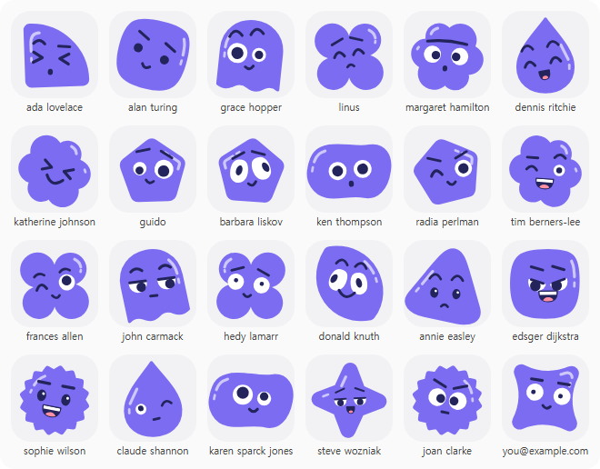
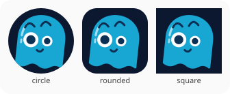

<div align="center">

# name2face

**Give any name, username or ID a cute SVG face that never changes. One Python file, no Node, no API.**

A stdlib-only Python port of [Blobz](https://github.com/lirena00/blobz) avatars: the same name and palette give the **same SVG, byte for byte**, so your Python backend and your React frontend draw the same face.

Works with **Claude Code** and **Codex**.

 



<sub>Real output of `python demo.py` (`docs/gallery.svg`, rasterized for this page). Every face comes from the name under it.</sub>

</div>

## Quick start
```bash
git clone https://github.com/Dodai0419/name2face && cd name2face
python name2face.py "ada lovelace" > ada.svg
```
```
<svg xmlns="http://www.w3.org/2000/svg" viewBox="0 0 80 80" width="80" height="80" role="img" aria-label="Blob avatar for ada lovelace">...
```
No `pip install`: it only uses the Python standard library.

## Gallery

**One name, six palettes** (`--bg` / `--body`), `--frame circle`:


**Three frames** for the same name:



| You want | Command |
|---|---|
| One SVG on stdout | `python name2face.py "ada lovelace" > ada.svg` |
| A file per user | `python name2face.py alice bob carol -o avatars/` → `avatars/alice.svg`, ... |
| A page to eyeball them | `python name2face.py alice bob carol --html faces.html` |
| Your brand colours | `python name2face.py alice --bg "#0b1830" --body "#18a6d3"` |
| A round frame | `python name2face.py alice --frame circle` (`rounded` is default, `square` too) |
| From Python | `from name2face import avatar; svg = avatar("user@example.com")` |

## The problem
- New users get a grey silhouette, or you pay an image API to draw something friendlier.
- The nice avatar libraries are npm packages, so a Django, Flask or FastAPI backend, a static-site build or an email template has to start Node to get the same face.
- Storing a generated PNG per user means storage, cache invalidation and a migration when you change colours.

## The solution
| Idea | Fixes |
|---|---|
| **Name → hash → 11 features** (shape, eyes, look, mouth, brows, gap, tilt, shift, face angle, mirror) with cyrb53 + mulberry32, exactly like Blobz | The same face everywhere, nothing stored |
| **One stdlib Python file** that writes the SVG string directly | No Node, no npm, no image API |
| **Byte-identical to `@blobz/avatar-core`** | Frontend (React) and backend (Python) agree on every user's face |

## Use with Claude Code
```bash
/plugin marketplace add Dodai0419/name2face
/plugin install name2face@name2face
```
Then ask: *"give every user in seed.json a default avatar under static/avatars"*.

## Use with Codex (ChatGPT)
```bash
git clone https://github.com/Dodai0419/name2face && cp -r name2face/skills/* ~/.codex/skills/
```
Or copy `AGENTS.md` into your project root.

## Same output as upstream
Checked against `@blobz/avatar-core` (lirena00/blobz commit `8b492ed`, run with Node 24 straight from `src/avatar.ts`):

| Check | Result |
|---|---|
| Upstream's own test digests (`Janaki`, `Blobz <Admin>`, the all-features custom case) | same SHA-256 |
| 20,012 names: 13 edge cases (unicode, CJK, emoji, `&<>"`, 200 chars, spaces, mixed case) + 20,000 random, across 4 palettes (one dark) and 3 frames | **20,012 / 20,012 byte-identical** |
| Every value of every feature, forced through `overrides`, × 6 eye styles × 2 palettes | **1,356 / 1,356 byte-identical** |

`tests/golden.jsonl` keeps 29 upstream SVGs that together hit every feature value, frame and palette, and the test suite compares against them.

Not ported: upstream's `createCustomAvatar` editor API (pick features by name). `overrides` with feature indexes covers the same faces.

## Benchmarks
Windows 11, Python 3.11.1, Node 24.20.0, both called in-process on a busy machine; 5 alternating runs of 5,000 names each.

| | `@blobz/avatar-core` (TypeScript) | name2face (Python) |
|---|---|---|
| lines (non-blank) | 896 (`src/avatar.ts`, library only) | **298** (library + CLI + HTML gallery) |
| file size | 28.7 KB | **20.0 KB** |
| runtime dependencies | Node.js (or a bundler) | **none** (Python stdlib) |
| time per avatar | 128–197 µs | 191–266 µs |
| one avatar from a cold process | 362–641 ms (`node one.mjs`) | 389–527 ms (`python name2face.py ada`) |

The port is about as fast as the original (a bit slower per avatar, similar cold start). Its gain is that it is a third of the code and runs where Python already is. Reproduce: `python -m unittest -q`, and time `name2face.avatar()` with `time.perf_counter`.

## Inspired by
- [lirena00/blobz](https://github.com/lirena00/blobz) (MIT): the avatar design, shapes, hash, random generator and SVG layout, ported line by line from `packages/avatar-core/src/avatar.ts`.

## Roadmap
- [ ] `--png` output through an optional rasterizer
- [ ] Feature names (`--eyes wink --mouth grin`) like upstream's custom avatar API
- [ ] A tiny Flask/FastAPI route example

## License
MIT. Includes the copyright notice of the upstream project.
